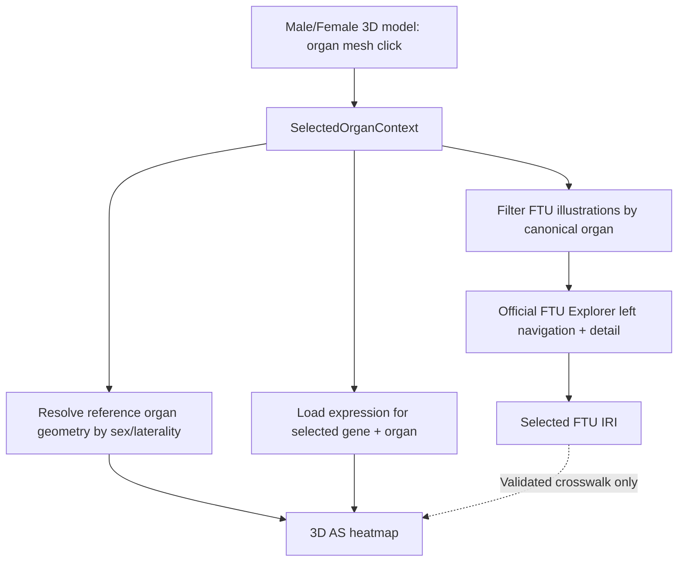

# HRA Organ → FTU → Biomarker Explorer

> **Codex 可执行开发任务书 / Product Requirements + Technical Implementation Plan**  
> 文档版本：v1.0 · 2026-10-26  
> 项目代号：**Organ–FTU–Expression Explorer**  
> 语言：网页 UI 默认英文；本任务书中文。  
> 项目性质：可运行、可部署、使用真实 Human Reference Atlas (HRA) 数据的交互式研究网站。

---

## 0. 给 Codex 的总指令（请先读）

你是一名高级全栈工程师和科学可视化工程师。请**在当前工作目录中实际搭建这个网站**，而非仅产出架构建议、效果图或伪代码。依据以下任务分阶段执行，优先打通一条真实数据闭环，再扩大器官范围。

**核心用户故事：** 用户在网页顶部看到两个人体 3D 模型（Male / Female），点击其中一个器官（例如 Female 的左肾），网页中部只显示该器官的全部 FTU（Functional Tissue Unit），保留 FTU Explorer 原有的左侧 FTU 导航及右侧插画、cell type、biomarker 和 source detail；网页底部根据所选器官及基因，展示参照 `as-b.ipynb` 实现的 **3D anatomical-structure biomarker expression heatmap**。

**必须执行的原则：**

1. **真实数据优先**：不要以假模型、静态假截图、随机生成的表达值、硬编码的“模拟 3D 热图”作为完成结果。可以使用**明确标注的测试 fixture** 进行自动测试，但不得混进正式 UI 数据。
2. **绝不加载 tissue blocks**：无需 RUI 样本坐标、donor、tissue block、sample cubes、采样统计或 EUI 的其他面板。选择器官只基于 anatomy mesh / ontology mapping。
3. **优先独立实现**：React + TypeScript + Three.js/R3F 实现主体；官方 FTU Explorer 用 Web Component 复用。不要通过“隐藏原 EUI 左右栏”假装完成。
4. **分清三个数据层级**：Organ selection 驱动 FTU 集合和第三层 organ-level expression；FTU selection 驱动 FTU 详情。**默认不要声称 FTU selection 可以一对一改变 3D anatomical expression**，除非有经过核对的 crosswalk。
5. **先验证上游资源**：外部 API、CDN 脚本、GLB 下载 URL、CORS、字段和模型大小可能变化。第一阶段先输出 `docs/integration-probe.md`，记录实测结论、版本、失败及替代方案。
6. **可以合理自主决策**：遇到非关键实现细节自行选择、记录 ADR；不要卡在反复询问需求上。遇到第三方链接或数据不可达时，完成其余可完成部分，准确说明阻塞，不要把 stub 标为完成。
7. **及时交付**：每完成一个阶段运行测试并提交清晰的 commit（如环境支持 Git）；最终在 README 提供一键启动流程，并输出测试报告、界面截图及未完成项。

### 最终必须交付

- 可运行的源代码仓库（frontend、必要的 backend、ETL scripts、tests、docs）。
- `README.md`：安装、数据准备、开发启动、生产构建和部署步骤。
- `docs/integration-probe.md`：API/CDN/3D 模型的验证记录。
- `docs/data-dictionary.md` 与 `docs/data-provenance.md`：字段、ontology mapping、数据版本、许可证、来源和表达量统计口径。
- `docs/model-manifest.md` 或机器可读 `model-manifest.json`：每个 GLB 的原始地址、版本、sha256、大小、授权与 mesh→ontology 映射覆盖率。
- 基础自动测试、关键 E2E 测试，至少一张实际页面截图。
- 可直接访问的开发站点与明确的部署配置；**不要承诺无法自行完成的部署**。

---

## 1. 产品目标和视觉结构

### 1.1 单页布局

```text
┌─────────────────────────────────────────────────────────────────────────┐
│ Header: Organ–FTU–Expression Explorer     About | Data Sources | Help  │
├─────────────────────────────────────────────────────────────────────────┤
│ SECTION A — Interactive Anatomy                                     │
│                                                                         │
│          Male 3D body                    Female 3D body                 │
│       translucent skin +               translucent skin +              │
│       colored organs                   colored organs                  │
│                                                                         │
│   Hover → organ tooltip; Click → set selected organ/sex/laterality      │
│   [Reset view] [Show skin] [Isolate organ] [Fit selected]               │
├─────────────────────────────────────────────────────────────────────────┤
│ Selected: Female / Left Kidney  |  Kidney FTUs  |  8 available*          │
├─────────────────────────────────────────────────────────────────────────┤
│ SECTION B — FTU Explorer                                                │
│ ┌────────────────────────┬──────────────────────────────────────────┐   │
│ │ Kidney only           │ Original HRA FTU illustration / details  │   │
│ │ • Ascending thin…     │                                          │   │
│ │ • Cortical collect…   │ [Interactive illustration]               │   │
│ │ • Descending thin…    │ [Cell types / biomarkers / sources]       │   │
│ │ • Inner medullary…    │                                          │   │
│ │ • Nephron             │ FTU changes only this FTU detail          │   │
│ │ • Outer medullary…    │                                          │   │
│ │ • Renal corpuscle     │                                          │   │
│ │ • Thick ascending…    │                                          │   │
│ └────────────────────────┴──────────────────────────────────────────┘   │
├─────────────────────────────────────────────────────────────────────────┤
│ SECTION C — Organ-level Biomarker Expression (AS-B visualization)       │
│ Organ: Kidney | 3D specimen: Female Left Kidney | Gene: [XIAP ▼]       │
│ ┌──────────────────────────────────────┬───────────────────────────┐   │
│ │ Color-coded 3D anatomical model      │ Mean expression by AS     │   │
│ │ rotate / zoom / hover / focus        │ Gene information         │   │
│ └──────────────────────────────────────┴───────────────────────────┘   │
│ Viridis colorbar: low ──────────────────────────────────────── high      │
│ Source / dataset version / aggregation / missing-data explanation       │
├─────────────────────────────────────────────────────────────────────────┤
│ Attribution • Licenses • Scientific disclaimer                          │
└─────────────────────────────────────────────────────────────────────────┘

* 8 是 2026-10 可见的 Kidney FTU illustrations 数；生产代码必须动态读取 API，
  不能把“8”或全部器官清单当作永久不变的硬编码。
```

### 1.2 必须完成的用户交互

| ID | 用户动作 | 正确行为 |
|---|---|---|
| UX-01 | 打开网页 | 男/女半透明人体可见；器官用不同颜色；默认没有 tissue blocks；不要求先选择样本。 |
| UX-02 | 鼠标旋转、滚轮缩放模型 | Male 和 Female 3D Viewer 能独立控制；提供 reset / fit。 |
| UX-03 | Hover Female Left Kidney | 目标器官高亮，tooltip 显示 `Kidney · Left · Female`。 |
| UX-04 | Click Female Left Kidney | `selectedOrgan=Kidney`，`selectedSex=Female`，`selectedLaterality=Left`；下方两个 Section 更新；自动滚动到 FTU 标题或提供“Explore Kidney”动作。 |
| UX-05 | Click Male Right Kidney | FTU 列表仍然是 **Kidney 的同一组 FTUs**；3D 上的选择和下方 3D model 改为 Male Right Kidney。 |
| UX-06 | 点击 Kidney 下的 Nephron | 官方 FTU illustration 与相关 cell/biomarker/source details 更新；左侧不出现其他器官。 |
| UX-07 | 点击另一 organ（如 Liver） | FTU navigation 换成 Liver FTUs；旧 FTU selection 清空或换成该 organ 第一条有效 FTU；gene search 状态按约定保留，重新查表达数据。 |
| UX-08 | 选择或输入基因（如 XIAP） | 下方 3D 结构按该基因的真实 `mean_expr` 上色；legend 随当前有效数据更新。 |
| UX-09 | 选择没有 FTU 的器官 | FTU 区显示 `No FTU illustrations currently available for this organ.`；**不能显示上一个器官的内容**；第三层如有数据仍可正常显示。 |
| UX-10 | 选择没有表达数据的 gene/organ | 显示真实 empty state（不能用 0 伪装缺失，不能用随机颜色）。 |
| UX-11 | 手机 / 低分辨率 | 3D 和 FTU 能纵向排列；若官方完整组件有最小宽度，提供横向内容容器与辅助提示，不发生不可恢复的溢出。 |

### 1.3 非目标（v1 不做）

- EUI tissue blocks、注册样本、donor 细节、Spatial Search、sample statistics。
- 在线运行 Jupyter Notebook、让访客安装 Python、用户上传实验数据。
- 为每个 FTU 人工制作新的 3D 模型。
- 声称 FTU illustration 对应 gene expression 的空间热区，除非确有 crosswalk 和明确的数据分辨率依据。
- 将男/女**模型外形的性别**误报为男/女**基因表达数据的统计分层**。
- 临床诊断、病理结论、药物推荐。

---

## 2. 已核实的官方资源与必须执行的核验

> 下列“**源代码/文档确认**”表示其实现或地址存在于官方仓库/页面，不代表已经从本执行环境测得 API 200、CORS 和 3D 资源下载成功。**Codex 必须在目标开发环境做 live probe。**

| 功能 | 官方资源 | 使用方法 | 状态 |
|---|---|---|---|
| 原始目标网站 | https://apps.humanatlas.io/eui/ | 视觉/交互参考，不复制含 tissue block 的整个应用 | 官方应用 |
| 官方 UI monorepo | https://github.com/hubmapconsortium/hra-ui | 阅读 UI、FTU 组件实现；MIT license（核对仓库 LICENSE） | 源代码确认 |
| Body UI web component | https://github.com/hubmapconsortium/hra-ui/tree/main/apps/ccf-body-ui-wc | 可参考场景映射/选中事件，但**其当前输入仍牵涉样本数据**；主方案不直接依赖该样本接口 | 源代码确认 |
| HRA 3D Reference Library | https://humanatlas.io/3d-reference-library | 下载/复用官方 male/female GLB 器官模型 | 官方数据页，CC BY 4.0 |
| Male whole-body model | https://3d.nih.gov/entries/3DPX-021022 | `hra-reference-organ-united-male-v1.5.glb` 的下载入口之一 | 页面确认，下载实测待办 |
| Female whole-body model | https://3d.nih.gov/entries/3DPX-020992 | `hra-reference-organ-united-female-v1.5.glb` 的下载入口之一 | 页面确认，下载实测待办 |
| 官方 FTU library | https://humanatlas.io/2d-ftu-illustrations | 检查 FTU 清单/数据发布版本；包括 Kidney 8 项 | 页面确认，CC BY 4.0 |
| FTU Explorer | https://apps.humanatlas.io/ftu-explorer/ | Section B 功能与布局参照 | 官方应用 |
| FTU Embedding Guide | https://github.com/hubmapconsortium/hra-ui/blob/main/apps/ftu-ui/EMBEDDING.md | `<hra-ftu-ui>`、`illustrations`、`selectedIllustration`、event | 源代码确认 |
| FTU 组件源码 | https://github.com/hubmapconsortium/hra-ui/blob/main/apps/ftu-ui/src/app/app.component.ts | 动态 inputs / events；切换 FTU 的逻辑 | 源代码确认 |
| FTU 数据实现 | https://github.com/hubmapconsortium/hra-ui/blob/main/libs/services/src/lib/ftu-data/ftu-data.impl.ts | 用 `organ_id` / `organ_label` 构造左侧 tissue tree | 源代码确认 |
| FTU illustrations API | https://apps.humanatlas.io/api/v1/ftu-illustrations | JSON-LD `@graph`；按 organ 分组/筛选 | 官方代码中的生产 URL；可达性待测 |
| 参考 3D scene metadata | https://apps.humanatlas.io/api/v1/rui-reference-data | `sceneNodeLookup`、`reference_organ`、`representation_of`；匹配 node→ontology | Notebook 指定 URL；可达性待测 |
| AS-B notebook | https://github.com/cns-iu/hra-pop-notebooks/blob/main/as-b/as-b.ipynb | `mean_expr` 聚合、3D 着色算法 | 代码已检查 |
| HRApop 数据 | https://github.com/x-atlas-consortia/hra-pop | v1.1 报表及字段来源 | Notebook 使用 |
| HRApop v1.1 报表 | https://github.com/x-atlas-consortia/hra-pop/raw/refs/heads/main/output-data/v1.1/reports/atlas-ad-hoc/datasets-as-ct-gene.csv.gz | ETL 原始输入；**不要下载到浏览器** | Notebook 指定 URL；大小/可达性待测 |
| FTU 数据补充材料 | https://github.com/cns-iu/hra-ftu-explorer-supporting-information | `ftu-datasets.jsonld` / `ftu-cell-summaries.jsonld` 的预处理逻辑 | 源代码确认 |

**提醒：** HRA 不同模型、FTU 插画、HRApop 版本可能不同步。写一个 `data-sources.lock.json`，为每个来源明确 version / retrieval date / URL / sha256 / schema version / license，而不是把 `latest` 当作可复现版本。可以使用当前 HRA 3D library 的 v2.5 作为候选，但须先确定该版本是否与选用的 scene metadata/模型文件匹配；不要强行把不同 release 的 mesh ID 拼在一起。

---

## 3. 建议技术栈及工程结构

### 3.1 技术选型

- **Frontend**：Vite + React + TypeScript，CSS Modules 或 Tailwind（二选一、保持风格统一）。
- **3D**：`three` + `@react-three/fiber` + `@react-three/drei`；Raycaster/mesh pointer events、OrbitControls、GLTFLoader、lazy loading。
- **页面状态**：Zustand 或 React context + reducer；只维护一个全局的 `selectedOrganContext`。
- **数据请求**：TanStack Query；负责缓存、abort、loading/error states。
- **FTU**：首选官方 `<hra-ftu-ui>` Custom Element；通过 DOM properties 而不是把超大 JSON 强转成 HTML 字符串。
- **数据 ETL / 后端**：Python 3.12+、pandas（chunked）、可选 DuckDB/SQLite；FastAPI 用于 `genes` 搜索和 organ/gene expression 的动态查询。不要让浏览器读取整个 CSV.gz。
- **测试**：Vitest + React Testing Library、pytest、Playwright；可选 axe-core accessibility。
- **部署**：静态前端 + Python API（同域 reverse proxy 或 serverless container）；如果先部署只有静态数据的 demo，必须标明 gene coverage 范围。
- **包版本**：安装经测试可兼容的稳定版本并锁定 lockfile；不要盲目指定过期 API。

### 3.2 建议目录

```text
organ-ftu-expression/
├── README.md
├── LICENSES.md
├── data-sources.lock.json
├── .env.example
├── package.json
├── web/
│   ├── index.html
│   ├── src/
│   │   ├── app/App.tsx
│   │   ├── components/
│   │   │   ├── anatomy/BodyPanel.tsx
│   │   │   ├── anatomy/AnatomyScene.tsx
│   │   │   ├── anatomy/OrganMesh.tsx
│   │   │   ├── ftu/FilteredFtuExplorer.tsx
│   │   │   ├── expression/ExpressionViewer.tsx
│   │   │   ├── expression/GenePicker.tsx
│   │   │   ├── expression/ExpressionLegend.tsx
│   │   │   └── ui/LoadingErrorEmpty.tsx
│   │   ├── data/organRegistry.ts
│   │   ├── data/ontology.ts
│   │   ├── hooks/useFtuCatalog.ts
│   │   ├── hooks/useOrganExpression.ts
│   │   ├── store/selection.ts
│   │   ├── types/hra.ts
│   │   ├── utils/viridis.ts
│   │   └── styles/
│   ├── public/
│   │   ├── models/              # 优化后且保持节点 ID 的 GLB
│   │   └── data/                # 版本固定的小型 manifest / cache
│   └── tests/
├── api/
│   ├── app/main.py
│   ├── app/models.py
│   ├── app/services/expression.py
│   ├── requirements.txt 或 pyproject.toml
│   └── tests/
├── scripts/
│   ├── probe_sources.py
│   ├── fetch_reference_models.py
│   ├── build_model_manifest.py
│   ├── build_organ_registry.py
│   ├── build_ftu_catalog.py
│   ├── build_expression_db.py
│   └── validate_mappings.py
├── data/
│   ├── raw/                    # 默认不提交的大文件
│   ├── processed/              # 生成物或存储卷
│   └── fixtures/               # 仅供测试、明确标明 synthetic
├── docs/
│   ├── integration-probe.md
│   ├── architecture.md
│   ├── data-dictionary.md
│   ├── data-provenance.md
│   ├── model-manifest.md
│   ├── decisions/
│   └── validation-report.md
└── e2e/
    └── kidney-flow.spec.ts
```

> 如果 Codex 所在目录已有 React 或 Python 项目，应在不破坏原仓库的前提下适配，而不是强行重建整个项目。推荐保持上述逻辑分层，不必机械复制目录名。

---

## 4. 全站的数据契约（先定义，后写 UI）

### 4.1 全局选择状态

```ts
export type BiologicalSex = 'male' | 'female';
export type Laterality = 'left' | 'right' | 'midline' | 'unspecified';

export type SelectedOrganContext = {
  organKey: string;              // canonical app key: e.g. 'kidney'
  organLabel: string;            // 'Kidney'
  organOntologyIds: string[];   // UBERON/FMA identifiers, ideally full IRIs
  sex: BiologicalSex;           // anatomical model sex, not expression cohort sex
  laterality: Laterality;       // side of clicked mesh
  referenceOrganIri?: string;   // HRA model instance versioned IRI
  sceneNodeIds: string[];       // original mesh IDs / scene IDs
};

export type ExplorerSelection = {
  organ: SelectedOrganContext | null;
  selectedFtuIri: string | null;
  selectedGeneId: string;       // e.g. XIAP after matching canonical gene catalog
  expressionStratification: 'pooled' | 'male' | 'female';
};
```

**状态联动规则：**

- A 区点击 mesh → 规范化 `organKey` + `sex` + `laterality` → 更新 B、C。
- B 区选择 FTU → **只**更新 `selectedFtuIri` 和 FTU 详情；不偷偷把 C 的 expression 数据改变为 FTU-specific。
- C 区选择 gene → 保留当前 organ、sex、laterality，查询新的 gene expression。
- 切换 organ → 取消旧请求（AbortController），避免旧结果覆盖新结果；旧 FTU IRI 无效时自动重置。
- 切换 Female↔Male，同一器官的 **FTU 图谱保持相同**；但上、下 3D reference model 的 geometry/ref IRI 随 sex/laterality 改变。

### 4.2 统一 organ registry（至关重要）

必须创建一个**人工可审计、程序可检查**的 mapping registry，而不是靠碰运气的 string `.includes()` 把模型名对应到 FTU：

```ts
export interface OrganRegistryEntry {
  organKey: string;                 // 'kidney'
  displayName: string;              // 'Kidney'
  ftuOrganId?: string;              // 从真实 illustrations catalog 解析出的 organ_id
  ftuOrganLabel?: string;           // 例如 'Kidney'
  organOntologyIds: string[];       // ontology IRIs/CURIEs；不可凭显示名臆造
  referenceModels: Array<{
    sex: 'female' | 'male';
    laterality: 'left' | 'right' | 'midline' | 'unspecified';
    referenceOrganIri: string;
    glbPath: string;
    sceneNodeIds: string[];
  }>;
  sourceRelease: string;
}
```

**Left Kidney 与 Right Kidney → `organKey='kidney'` 共享同一 FTU 子集**，但不可丢失 laterality；`representation_of`（ontology）和 `reference_organ`（模型实例）是两个不同 ID 维度。先从真实数据列出/验证所有匹配，再决定细节。

### 4.3 不可混用的 ID

- `organKey`：我们应用的逻辑器官，如 `kidney`，用于 UI 过滤。
- `organ_id`：FTU illustration 数据中的器官字段；需要从 JSON-LD 检查确切值。
- `ftuIri`：例如 `https://purl.humanatlas.io/2d-ftu/kidney-ascending-thin-loop-of-henle`，是具体 FTU illustration ID。
- `reference_organ`：scene metadata 里带版本和性别/侧别的 3D 器官实例 IRI。
- `representation_of`：scene node 对应的 anatomical ontology URI。
- `as_id`：HRApop 的 anatomical structure ID（如 `UBERON:...` 或 `FMA:...`），应经过严格 URI 规范化后用于 matching。
- `gene_id` / `gene_label` / `ensembl_id`：不要把这些三者不加区分；gene search 必须明确选择的 canonical ID 和 label。

---

## 5. Phase 0 — 资源与数据可行性探测（**先做；不得跳过**）

### Step 0.1 建立项目 + 基础质量闸门

- 初始化仓库与 React/TS 前端、Python API 工程。
- 设置 lint、format、typecheck、unit test、Playwright。
- 生成 `.env.example` 和 README 的最短启动说明。
- 确认 Node/Python/OS 环境版本，并记录到 `docs/integration-probe.md`。

### Step 0.2 测试 FTU 官方 API 和 CDN

按顺序实际探测（遇到网络权限问题，写清失败原因）：

```bash
curl -IL 'https://apps.humanatlas.io/api/v1/ftu-illustrations'
curl -L --fail --retry 2 \
  'https://apps.humanatlas.io/api/v1/ftu-illustrations' \
  -o data/raw/ftu-illustrations.json

curl -IL 'https://cdn.humanatlas.io/ui/ftu-ui/styles.css'
curl -IL 'https://cdn.humanatlas.io/ui/ftu-ui/wc.js'
curl -IL 'https://cdn.humanatlas.io/ui/ftu-ui/main.js'
```

`wc.js` 和 `main.js` 是**不同版本构建可能出现的入口**，以目标 CDN 实测和官方文档为准，**只能加载一套有效 bundle，不能两套都加载**。不用在 React SPA 的 `<head>` 添加跨站的全局 `<base href>`；优先用 `hra-ftu-ui.baseHref` 与资源的绝对 URL，以免破坏 Vite/React Router 路由。

检查响应的 `@graph` 是否存在、每条 item 是否有 `@id`、`organ_id`、`organ_label`、`label`、`mapping`、`illustration_files`。实测 Kidney 数量，并将所有 `organ_id` 去重打印到探测报告。官方页面在 2026-10 显示 Kidney 8 个 FTU，但数量以锁定的 API 数据为准。

### Step 0.3 选择和检查 3D 模型

1. 通过 HRA 3D Reference Library 下载候选 whole-body / organ GLB。链接入口包括 NIH 3D 的 Male、Female United Model，但**不要未经验证就假设它们足够轻、包含正确 mesh ID、包含所有新版本器官**。
2. 检查每个文件的 glTF node names、mesh count、geometry units、world transform、sex/laterality 标签、可点击性和文件大小。
3. 如有版本冲突，优先选用**同一 release 的男女/器官模型 + 可匹配的 scene metadata**；必要时分别使用 `skin GLB + individual organ GLBs` 构建与 EUI 相近的体验。
4. 严禁把 model mesh ID 丢弃后再用“模型第 N 个 mesh”作为长期映射方式。
5. 先做一个最小测试场景，验证 Female Left Kidney 的 mesh 可被点击，并能关联到 registry 中 `kidney`。
6. 记录哪些器官没有已确认模型、哪些没有 FTU、哪些没有 expression；其状态必须可在 UI 区分。

### Step 0.4 验证 AS-B 原始数据与 schema

- 阅读 notebook 中 `MY_GENE_LABEL = 'XIAP'`、`MY_GENE_SYMBOL = 'XIAP'`、`MY_AS_ID`、`sceneNodesSelected`、`map_mean_expr_to_color`、`BodyUi(scene=...)` 相关 cell。
- 下载/探测 v1.1 的 `datasets-as-ct-gene.csv.gz`；记录 `Content-Length`（若有）、实际列名、行数、数据版本。
- 探测 `rui-reference-data`，记录 `sceneNodeLookup` 的一个 kidney sample（字段/IRI/版本）、male/female 可用 coverage。
- 计算可以匹配的 `as_id → representation_of` 比例，输出至少：`scene nodes total`、`matched with expression`、`missing expression`、`unmatched IDs`。
- **重点核实 kidney + XIAP 是否有真实可渲染的节点和值**。若覆盖不足，优先把成功数据链路打通于 notebook 原始示例（Female Large Intestine + XIAP），同时保持 Kidney 的 FTU 与场景选择功能；不要伪造 Kidney 的 expression。

### Phase 0 完成标准

- `integration-probe.md` 内包含 HTTP/API/CDN 状态、实际字段、version、截图或终端检查记录。
- 真实数据可用时建立最小运行 demo：至少能点击一个真实 3D kidney mesh，并打印结构化 `SelectedOrganContext`。
- 若外部资源被阻断，则有可复现的失败日志、清楚的下一步、正式与测试 fixture 隔离。

---

## 6. Phase 1 — Section A：Male / Female 3D anatomy

### Step 1.1 模型准备与优化

- 建立 `scripts/fetch_reference_models.py`（URL/版本来自 manifest，不散落在前端 source）。
- 下载原始 GLB 到不提交的大文件夹，记录 sha256/license/source version。
- 用 `gltf-transform` / Blender CLI / meshoptimizer（具体工具按文件内容决定）减小体积；可以 decimate 或压缩纹理/顶点，但**保留原始 mesh name、semantic ID 或产生一份确定的旧新 ID mapping**。
- 如果 united GLB 首屏过慢，可把皮肤与主要器官分开，渐进加载。可以在 Phase 1 先支持核心器官，不要求一次加载所有解剖结构；清楚标注支持列表。
- 皮肤默认低 alpha、深蓝色；器官为不透明或高 alpha 的不同颜色。将 `transparent / depthWrite / renderOrder` 与双面 skin picking 行为处理正确，以保证内层 organs 可以实际被选中。

### Step 1.2 编写 R3F anatomy viewer

- `<BodyPanel sex='male'/>` 与 `<BodyPanel sex='female'/>` 并排显示，独立 camera 与 controls。
- `OrbitControls`: orbit / zoom / pan / reset / fit selected。
- 悬停 tooltip：organ label、sex、laterality；mousemove 使用 throttling，避免过多状态更新。
- 点击具体器官 mesh：通过 `mesh.userData` 或 mesh→registry 映射找到 canonical organ；对 skin/background 的点击不改变选择。
- selected organ 高亮，其余器官降低亮度但仍可查看；`Isolate organ` 和 `Show/hide skin` 是独立切换项。
- 鼠标 hover/click 事件考虑 nested mesh，mesh part → closest organ group 的聚合。
- 关闭 tissue block 相关的所有数据 fetch、component 和 state；检查 Network 面板没有 sample/tissue-block 接口请求。

### Step 1.3 选择状态

`onOrganClick` 应提供**真实、可追溯**的对象，不是只传字符串：

```ts
function onOrganClick(payload: SelectedOrganContext) {
  useExplorerStore.getState().selectOrgan(payload);
  // This action resets stale selectedFtuIri and causes FTU/expression updates.
}
```

特别处理：左右 kidney、左右 lung 或成对 organ；只有某一性别有的器官（如 uterus/prostate）不会强制加载不存在的另一性别模型。

### Phase 1 完成标准

- 男女模型可见并可转动；至少 Kidney 可从正确性别与侧别被点击。
- 点击左/右 kidney 都得到 `organKey='kidney'`，但 laterality 不丢失。
- 无 tissue block 数据或几何；多次切换不导致 webgl resource leak。

---

## 7. Phase 2 — Section B：只显示当前 Organ 的全部 FTU

### Step 2.1 读取官方 FTU catalog 并过滤

从官方 `ftu-illustrations` JSON-LD 创建 catalog（可通过本地 API proxy / versioned snapshot 提供，以规避 CORS 和线上变动）：

```ts
type FtuIllustration = {
  '@id': string;
  label: string;
  organ_id: string;
  organ_label: string;
  representation_of: string;
  mapping: Array<{
    label: string;
    svg_id: string;
    svg_group_id: string;
    representation_of: string;
  }>;
  illustration_files: Array<{ file: string; file_format: string }>;
};

type FtuCatalog = { '@graph': FtuIllustration[] };

function filterFtusForOrgan(
  catalog: FtuCatalog,
  ftuOrganId: string,
): FtuCatalog {
  const normalized = ftuOrganId.trim().toLowerCase();
  return {
    '@graph': catalog['@graph'].filter(
      (x) => x.organ_id.trim().toLowerCase() === normalized,
    ),
  };
}
```

这是**示例过滤逻辑**；真实生产时 `ftuOrganId` 必须来自 organ registry / 验证过的 API 值，不能只靠 `organKey` 猜测。如果 API schema 与代码中的类型有差异，以实际版本的官方 Zod schema 和响应为准调整。

### Step 2.2 集成官方完整 FTU Explorer

优先嵌入支持原始左侧 tissue library + 右侧 illustration/details 的 **`<hra-ftu-ui>` 完整 Web Component**，不是只嵌入一个 SVG 插画。官方 `apps/ftu-ui/EMBEDDING.md` 已确认：

- `illustrations`：URL 或 JSON-LD object；可传**当前 organ 的 `@graph` 子集**。
- `selectedIllustration`：当前 FTU IRI（DOM 属性）。
- `summaries`：biomarker/cell summary 数据 URL 或对象。
- `datasets`：source/dataset metadata URL 或对象。
- `baseHref`：资源相对路径的根地址（camelCase DOM 属性）。
- `illustration-selected`：选择 FTU 的事件，`event.detail` 为 IRI。
- `cell-click` / `cell-hover`：FTU illustration cell interactions。

**集成实现示意：**

```tsx
// Pseudocode: use actual custom element type definitions in the implementation.
function FilteredFtuExplorer({ organ }: { organ: OrganRegistryEntry }) {
  const elementRef = useRef<HTMLElement & {
    illustrations?: FtuCatalog;
    selectedIllustration?: string;
    datasets?: string;
    summaries?: string;
    baseHref?: string;
  }>(null);

  const catalog = useFtuCatalog();
  const current = useMemo(
    () => filterFtusForOrgan(catalog.data, organ.ftuOrganId ?? ''),
    [catalog.data, organ.ftuOrganId],
  );

  useEffect(() => {
    const el = elementRef.current;
    if (!el || !current['@graph'].length) return;

    // Pass OBJECT, not JSON.stringify(...) into an attribute.
    el.baseHref = import.meta.env.VITE_FTU_BASE_HREF;
    el.illustrations = current;
    el.datasets = import.meta.env.VITE_FTU_DATASETS_URL;
    el.summaries = import.meta.env.VITE_FTU_SUMMARIES_URL;
    el.selectedIllustration = current['@graph'][0]['@id'];

    const handleSelect = (e: Event) => {
      const iri = (e as CustomEvent<string>).detail;
      // Validate iri belongs to current['@graph'] before updating store.
    };
    el.addEventListener('illustration-selected', handleSelect);
    return () => el.removeEventListener('illustration-selected', handleSelect);
  }, [current]);

  return current['@graph'].length ? (
    <hra-ftu-ui ref={elementRef as any} />
  ) : (
    <p>No FTU illustrations currently available for this organ.</p>
  );
}
```

此代码是架构示意，Codex 必须处理 **custom element 注册完成、异步初始化、React StrictMode 重复执行、切换 organ 后旧选中状态、event 回环、script/CSS 版本**。可用 `key={organ.organKey}` 强制重新挂载来规避第三方组件不支持的动态 schema 更新，但先检验性能和体验。

### Step 2.3 保留导航 + 全部 FTU 详情

- 左侧菜单只包含 selected organ 的 FTUs（例如点击 Kidney，不能再显示 Liver / Lung）。
- 保留官方的每个 FTU 的 illustration、cell type、biomarker、sources/tables/download（若对应数据可用）。
- 点击左侧 FTU 后，右侧显示正确 FTU 的 details。
- `summaries`、`datasets` 应连接**真实生产发布数据**或经过验证且版本固定的镜像：
  - `https://cdn.humanatlas.io/ui/ftu-ui/assets/TEMP/ftu-cell-summaries.jsonld`
  - `https://cdn.humanatlas.io/ui/ftu-ui/assets/TEMP/ftu-datasets.jsonld`
- 上述路径是官方 `hra-api` 的嵌入路由曾引用的路径；Codex 需实测 HTTP/status/schema，**不可假设永远存在或永久最新**。失效时优先以官方 `hra-ftu-explorer-supporting-information` 的 pipeline / 资源版本重建可用文件，写入 attribution/version。
- 若完整 Web Component 自带 HRA header，允许第一版保留；后续再通过 fork/配置去掉，不要通过 fragile CSS 破坏左侧导航。
- 若 SDK 在 React 页面不稳定，Plan B：自托管官方同版本构建/最小 fork，只修改 `tissue library` 的 data source。**不得直接用 iframe 嵌套官方全部器官网页冒充已过滤。** 若必须用 iframe，应为同域自托管版本，并提供有版本化的 `postMessage` 协议。

### Phase 2 完成标准

- 点击 Female/Male 任一 Kidney，均只出现 Kidney 子目录；官方页面目前列出 8 项，已选版本应读取完整集合。
- 至少两种 FTU（如 Nephron 与 Renal Corpuscle）能切换到不同插画与详情。
- 点击 Liver 时 kidney 导航和详情消失，不会闪回上一器官数据。
- FTU component 在 3D 场景之外独立正常运行，没有污染 React 全局路由或样式。

---

## 8. Phase 3 — Section C：AS-B notebook → 网页 3D Expression Visualization

### 8.1 先忠实复现 Notebook 算法

参考源：`https://github.com/cns-iu/hra-pop-notebooks/blob/main/as-b/as-b.ipynb`。Notebook 的关键事实：

- 从 HRApop v1.1 `datasets-as-ct-gene.csv.gz` 读取表格。
- 默认示例基因是 `XIAP`。
- 样例用 `df_result_b.groupby('as_id')['mean_expr'].mean()` 计算 **AS 级平均表达**。
- 通过 `curie_to_uri` 把 `FMA:` / `UBERON:` ID 映射到 ontology URI。
- 从 `rui-reference-data.json` 的 `sceneNodeLookup` 选取 `reference_organ` 对应的节点；排除 `landmark` 节点。
- 用 `representation_of` 与 AS ontology URI 关联；有数据的节点按 Matplotlib **viridis** 分配颜色，没数据的节点显示灰色 `[212,221,230,255]`。
- 用 `BodyUi(scene=sceneNodesSelected)` 显示可交互 3D structure，并绘制 colorbar。

**我们的目标不是嵌入 Jupyter widget 页面**，而是把其**数据转换和颜色规则**搬到 Python ETL/API + Three.js 3D viewer，用户在网页里无需 Python kernel。

### Step 3.1 ETL：预计算和存储真实表达数据

- `scripts/build_expression_db.py` 下载/读取锁定版本的 CSV.gz，按 chunk 流式处理；**不要整份数据在浏览器 fetch**。
- 校验真实列名：`as_id`、`mean_expr`、`gene_id`、`gene_label`，以及实际存在的 `ensembl_id` 等。记录缺失值、无效 ID、数值范围、重复行分布。
- 原始 Notebook 的统计口径是：**给定 gene → 按 `as_id` 对每条匹配记录的 `mean_expr` 做简单算术平均**。v1 首先忠实复现此结果，同时输出 `n_records`。不要随意改成按 donor、cell、dataset 加权的平均却仍标成 Notebook 结果。
- 可使用 DuckDB/SQLite 保存：`gene_index`、`as_gene_expression`、`data_version` 等。
- 大数据处理时可按 gene+AS 聚合 `sum_expr` 和 `count`，最后输出 `mean_expr = sum/count`；在分块之间正确合并统计，不允许先对各 chunk 求均值再均分 chunk means。
- 保留 NaN/missing 的含义；只有有效数值参与统计，使用明确的 `n_records`。
- 建立强类型 ontology ID 规范化工具：
  - `UBERON:0002080` → `http://purl.obolibrary.org/obo/UBERON_0002080`。
  - `FMA:...` → notebook 同口径 `http://purl.org/sig/ont/fma/fma...`（核验真实格式）。
  - 已经是 URI 的不得再拼接。
  - 对 HRA metadata 返回的 HTTPS/HTTP 别名，保留 source ID 并使用经过核实的 equivalence rules，**不能无证据地把所有 `http` 与 `https` 互换**。
- 数据探测报告必须包含与 notebook 示例 `XIAP + Female Large Intestine` 的数值对照（允许浮点容差）。

### Step 3.2 3D scene/ontology crosswalk

为每个选择的 `reference_organ`：

1. 从真实 `sceneNodeLookup` 取得该 reference organ 的 scene nodes，排除 landmark。
2. 对每个 node 保存：`sceneNodeId`、`reference_organ`、`representation_of`、`label`、geometry/mesh key。
3. 匹配 `normalized(as_id)` ↔ `normalized(representation_of)`，并验证 geometry 确实来自当前选定 male/female/left/right model。
4. 编写 `validate_mappings.py`，输出当前模型中有 geometry 但无 ontology ID、数据 ID 未匹配、重复 ID、多 mesh 指向同一 AS 的统计。
5. 多 mesh 同一 AS 可以共享颜色；一个 mesh 对应多个 AS 时必须明确决定并记录：优先使用更精确的 node mapping，不能随机选。
6. **没有 expression 的节点默认浅灰，而不是 0 表达**；没有任何匹配时展示 no-data，并给用户说明。

### Step 3.3 API 合约（推荐）

```http
GET /api/v1/health
GET /api/v1/organs
GET /api/v1/genes?q=XIAP&limit=20
GET /api/v1/expression?organKey=kidney&geneId=XIAP&sex=female&laterality=left
```

推荐 expression response（依据真实返回调整，但必须清晰）：

```json
{
  "organKey": "kidney",
  "referenceOrganIri": "<resolved-versioned-HRA-IRI>",
  "modelSex": "female",
  "laterality": "left",
  "geneId": "XIAP",
  "geneLabel": "XIAP",
  "expressionCohort": "pooled",
  "aggregation": "unweighted arithmetic mean of source mean_expr rows by as_id, following as-b.ipynb",
  "sourceVersion": "HRApop v1.1",
  "min": null,
  "max": null,
  "nodes": [
    {
      "sceneNodeId": "<real scene node IRI>",
      "ontologyId": "<real normalized ontology IRI>",
      "meanExpr": null,
      "nRecords": 0,
      "hasData": false
    }
  ]
}
```

上面 JSON 中的 `<...>`、`null` 是**仅供设计的 placeholder**；Codex 应以真实 scene 生成响应，返回真实 min/max；没有数据时保留 null，并提供 `coverage` 统计，**不能把 placeholder 当生产数据**。

### Step 3.4 Frontend：3D 热图 + 颜色条

- 用另一套独立的 R3F Canvas 展示**当前选中 reference organ 对应的 3D anatomical structure geometry**，支持 rotate、zoom、reset、fit、hover tooltip。
- 只使用真实 `meanExpr` 上色；和 notebook 一致使用 viridis `min→max`（按当前选中 organ/gene 的实际**有数据节点**范围归一化）。
- 全部值相等时必须安全处理 `min === max`（固定中点颜色并标注无变化或在 tooltip 展示相同值）；绝不产生 `NaN` 材质。
- `hasData=false`：显示固定灰色，hover 时显示 `No expression data`。
- 提供 Color Legend（min、max 和单位/统计口径）；可查看当前 anatomical structure 的 `mean_expr`, `n_records`, ontology ID。
- 提供 GenePicker 搜索/选择，基因不可识别时给出明确错误，不做随意文本匹配。
- 可增加侧边小型 `AS → meanExpr` 表格（按表达排序），便于用户确认着色合理。
- 拓展功能（非 MVP）：gene comparison、切换 global vs per-organ color scales、导出 PNG/CSV；不阻碍主流程。

### Step 3.5 Sex 差异的数据诚信要求

- `sex` 首先表示 **选择了哪一个 3D 解剖模型**，不代表 gene expression 已按 donor sex 筛选。
- Notebook 所展示的 `df_result_b.groupby('as_id')['mean_expr'].mean()` 并未在这一行按 sex 分组。除非确认 HRApop 报表有可靠 sex 字段并实现 sex-specific filtering/aggregation，否则底部 legend 标注：**Expression values are pooled; anatomical geometry is female/male reference model.**
- 如果将来实现 sex-specific expression，API 应显式提供 `expressionCohort='male'|'female'|'pooled'`，缺失 sex 数据不能被默认分配至男女。

### Step 3.6 FTU 与 AS-B 的联动边界

- **v1**：点击 Kidney → FTU Explorer 显示 Kidney 全部 FTUs；下方显示 Kidney **organ-level** 3D biomarker expression。点击任一 Kidney FTU 只改变 FTU 详情，下方不会宣称自己是那个 FTU 的 gene-specific 空间图。
- **v2 可选**：基于官方 FTU illustration `representation_of`、`mapping[].representation_of`、ASCT+B / ontology partonomy 做 crosswalk；仅当真实 ontology 映射成立时，允许点击 FTU 高亮一个或多个 3D anatomical structures，并标注映射来源和粒度。**这不是通过字符串相似度推测“FTU→3D mesh”**。

### Phase 3 完成标准

- 可以选择至少一个有真实数据覆盖的 organ+gene，看到**非静态、根据原始 `mean_expr` 计算**的 3D 热图及颜色条。
- 与 notebook 的 XIAP 示例比对成功，记录误差/聚合统计。
- 没有匹配数据时显示可理解的 empty state；绝不出现假彩色结构。
- 切换 sex 改变 3D model，但不会假称 pooled expression 是 sex-specific。

---

## 9. Phase 4 — 全站联动、数据正确性、性能与可访问性

### Step 4.1 端到端状态流



### Step 4.2 可靠性

- 所有 async API 请求支持 loading / retry / error / empty。
- 快速连续点击 organ/gene 不会出现 race condition、FTU IRI 错乱或旧 3D 模型泄漏。
- 本地开发和部署通过同域 API reverse proxy 优先解决 CORS；若跨域资源不允许请求，服务端镜像或预构建 snapshot，并保存 license/provenance。
- 模型文件采用缓存、lazy loading、必要压缩；模型加载进度可见；断网/超时有可读错误。
- 处理 WebGL context lost/recovered、Canvas dispose、材质和纹理释放（如卸载组件时需自行释放）。
- 一次最多渲染必要的 3D 场景；非可见区域可暂停绘制（但不能销毁未保存交互状态）。

### Step 4.3 性能目标（建议验收阈值，不用假装已达成）

- 桌面 Chrome 开发机：首个可交互人体目标 ≤ 10 s，关键反馈尽量 ≤ 200 ms；具体以资源带宽和模型复杂度记录实测。
- 第一次选中 organ 的 FTU 数据加载应有明显 progress；后续已缓存切换尽可能 ≤ 2 s。
- 超大型原始 GLB 不可不经评估全部同步进首屏；报告 raw→optimized file size、draw calls、初始内存、FPS。
- 优先降低 initial payload；同一器官不要重复下载相同 model。

### Step 4.4 UI 和无障碍

- 桌面采用三层纵向结构：A 两列 3D，B 左导航+主详情，C 3D+信息栏。
- 移动端采用单列或 Tab 切换 Male/Female，支持触控旋转/缩放；提供一个非 3D organ 列表作为键盘/屏幕阅读器的替代入口。
- 所有控件有 label、键盘焦点、可见 hover/selected 状态；图例不能仅依赖颜色解释数值。
- Footer 添加数据出处、CC BY 4.0 署名和 scientific-use disclaimer。

---

## 10. 测试计划（至少实现以下测试）

### Unit tests

1. `normalizeOntologyId()`：UBERON、FMA、已为 HTTP URI 的输入，错误格式，大小写与前导零。
2. `mapSceneNodeToOrgan()`：Male/Female + Left/Right kidney 归一化为同一 `organKey`，同时保留 sex/laterality。
3. `filterFtusForOrgan()`：Kidney 只返回 Kidney；无数据返回空列表；切换器官不遗留旧 FTU。
4. `aggregateMeanExpr()`：分 chunk 的 sum/count 得到与一次性 `mean()` 相同的结果，含重复、多 dataset、NaN、空值。
5. `viridisColor()`：最小值、最大值、中间值、`min=max`、无数据的灰色。
6. FTU event `illustration-selected`：只接受当前 subset 内的 IRI；监听器清理无内存泄漏。
7. Backend API schema + real data lookup：非法 gene、未知 organ、未覆盖 AS、性别可用性。

### E2E tests（Playwright）

- **E2E-A**：打开首页 → male/female canvas/主要器官/标识可见 → 无 tissue block。
- **E2E-B**：点击 Female Left Kidney → 页面显示 `Female · Left Kidney`，FTU 导航仅 Kidney，含 `Nephron` 和 `Renal Corpuscle`。
- **E2E-C**：点击 Nephron → FTU illustration 对应 `kidney-nephron`；再点 Renal Corpuscle → 图与名称变化。
- **E2E-D**：点击 Male Right Kidney → FTU 子集仍为 Kidney，3D reference model 改为 male/right；表达数据标识保持 `pooled`（除非真实支持 sex-specific）。
- **E2E-E**：点击 Liver → FTU 子集变成 Liver，不能看到 Kidney 内容。
- **E2E-F**：GenePicker 选 XIAP → 请求真实数据、热图颜色与 API 返回 min/max 一致；重新选择不存在的 gene → 正确 empty state。
- **E2E-G**：测试 “该 organ 无 FTU”“该 gene 无表达”“CDN 失败” 等状态，不得崩溃。
- **E2E-H**：快速连续点击器官 → 最后状态与最后点击一致，无过时结果覆盖。

**E2E 的 3D 点击定位建议：** 用稳定的 `data-testid` organ picker 替代入口作为自动化回退，同时保留一个真正 raycast-based 的浏览器交互集成测试。不要只测列表而完全跳过 3D mesh selection。

### 科学有效性校验

- 输出 `expression-validation.csv`：随机挑选至少 5 个或尽可能多的可匹配 AS，记录 notebook 值、ETL 值、相对/绝对误差、源 record 数。
- 输出 `mapping-coverage.json`：每个选中 organ 的 3D node total/matched/unmatched 与 FTU count。
- 明确区分：**No data**、**Mean expression=0**、**Not mapped**、**No 3D geometry**、**No FTU illustrations**。

---

## 11. 开发优先级与里程碑（Codex 必须按序推进）

| 优先级 / 阶段 | 要做的事 | 最小可展示成果 | 通过条件 |
|---|---|---|---|
| P0 — Integration probe | 核实 FTU API、CDN、GLB、HRApop 文件、scene IDs | `integration-probe.md` | 字段/模型可下载或准确报告受阻；不做猜测 |
| P1 — Real anatomy | 男女透明人体、可点击器官、统一 organ registry | 点击 Female Left Kidney | 动态获得结构化 organ selection；无 tissue blocks |
| P2 — Filtered FTU | 嵌入官方 FTU Web Component，按器官过滤 catalog | 点击 Kidney → Kidney-only FTU 导航、详情可切换 | 原始左导航与详情功能完整 |
| P3 — Expression ETL | 复现 as-b.ipynb 的 AS mean expression 聚合与映射 | `XIAP` + 有数据的参考器官 scene | 与 notebook 对照通过；无真实数据则报告覆盖缺口 |
| P4 — 3D expression | R3F 热图 + viridis colorbar + gene search | 真实结构着色 | 可交互、数值与 API 一致 |
| P5 — Polish & deploy | 性能、移动端、测试、license、docs | 可部署的 demo | Playwright/pytest/vitest/build 正常，README 可复现 |

**建议的第一条 end-to-end vertical slice：** Female Left Kidney → 只显示 Kidney FTUs → 点击 Nephron → 第三层显示 Kidney + XIAP 的真实结构表达（**仅当数据映射确实有覆盖**）。如果 Kidney + XIAP 无覆盖，优先保持 Kidney FTU 功能完整，同时用 notebook 原始的 Female Large Intestine + XIAP 验证第三层算法；两者打通后再统一、不得伪造匹配。

---

## 12. 验收标准 Definition of Done

以下条件**全部满足**才可称为 v1 完成：

- [ ] 单个 website 展示 Section A（Male/Female）、Section B（FTU）、Section C（3D expression）。
- [ ] Section A 3D 模型可旋转/缩放/点选器官，真实 mesh 与 organ registry 可追溯。
- [ ] 无 tissue block UI、geometry、network fetch 或 sample data dependency。
- [ ] 点击 Kidney 时 Section B 只展示 Kidney 对应的**全部当前可用 FTUs**，保留原始左导航和右侧完整详情。
- [ ] 点击至少两个 FTU 可显示真实不同的插画和关联详情。
- [ ] 左/右 kidney 和男/女 models 有明确选择状态；FTU 仍按 organ 汇总。
- [ ] Section C 展示至少一个真实 gene+organ 的 AS expression 3D visualization，计算符合 as-b notebook 的方法。
- [ ] `min/max`、missing structure grey、tooltip、来源、表达统计口径与实验数据一致。
- [ ] 若表达数据未按 sex 分层，界面明确标注 pooled expression。
- [ ] 所有不支持的数据组合有 empty/error state，绝不伪造数据。
- [ ] `npm run build`、TypeScript typecheck、pytest、Vitest、关键 Playwright 测试通过；记录运行结果。
- [ ] README 新机器可复现；重要来源和版本/许可证记录齐全。
- [ ] 提交实际页面截图，展示 A→B→C 联动；列出完整和未完成的功能清单。

**不可接受的“完成”：** 只有设计稿；只有 3D 静态图片；点击器官后 iframe 仍显示全部 organs；“基因热图”是固定随机颜色；仅有 notebook 截图；没有真实 organ ontology 映射；mock fixture 在正式页面被标成数据结果。

---

## 13. 首次运行、构建与回报格式

### 首次工程初始化（示意，按已有仓库情况调整）

```bash
# 在空目录中，建议：
npm create vite@latest web -- --template react-ts
cd web
npm install
npm install three @react-three/fiber @react-three/drei @tanstack/react-query
npm install -D vitest @testing-library/react @playwright/test

# Python 可独立运行（在项目根目录）
python -m venv .venv
# macOS/Linux: source .venv/bin/activate
# Windows: .venv\Scripts\activate
# 安装 api/requirements.txt 或 api/pyproject.toml 中的依赖

# 真实构建/启动脚本由 Codex 配置后写入 README：
# npm run dev, npm run build, npm run test, ...
# uvicorn api.app.main:app --reload（路径按实际项目结构调整）
```

### 推荐环境变量

```dotenv
# URLs are configurable and must be verified at bootstrap.
VITE_API_BASE_URL=http://localhost:8000
VITE_FTU_BASE_HREF=https://cdn.humanatlas.io/ui/ftu-ui/
VITE_FTU_DATASETS_URL=https://cdn.humanatlas.io/ui/ftu-ui/assets/TEMP/ftu-datasets.jsonld
VITE_FTU_SUMMARIES_URL=https://cdn.humanatlas.io/ui/ftu-ui/assets/TEMP/ftu-cell-summaries.jsonld
HRA_FTU_ILLUSTRATIONS_URL=https://apps.humanatlas.io/api/v1/ftu-illustrations
HRA_RUI_REFERENCE_DATA_URL=https://apps.humanatlas.io/api/v1/rui-reference-data
HRA_POP_VERSION=v1.1
```

**不建议把尚未探测的第三方 URL 写死在逻辑里。** CDN entry (`wc.js` 或 `main.js`) 由 probe 确认、配置并锁版本；环境变量不是可靠性替代。

### Codex 完成后按以下格式交付

```text
1. 目前已实现的功能（附截图 / demo URL）
2. 文件/目录说明与关键代码入口
3. 数据源实际版本、URL、license、API 可达性及 ontology mapping coverage
4. 安装和启动命令（可复制）
5. pytest / Vitest / Playwright / build 执行结果
6. 哪些内容需要我提供资源或权限（如果有）
7. 尚未完成项和下一步优先级（不要声称没有完成的内容已完成）
```

---

## 14. 重要参考链接（可直接用于 Codex 的检索）

1. [HRA Exploration UI](https://apps.humanatlas.io/eui/) — 第一层目标视觉参考。
2. [HRA UI monorepo](https://github.com/hubmapconsortium/hra-ui) — 官方 UI；项目 MIT License。
3. [HRA Body UI Web Component](https://github.com/hubmapconsortium/hra-ui/tree/main/apps/ccf-body-ui-wc) — 源代码参考；注意样本数据耦合。
4. [HRA 3D Reference Library](https://humanatlas.io/3d-reference-library) — GLB 模型与 license。
5. [NIH Male whole-body GLB page](https://3d.nih.gov/entries/3DPX-021022)；[Female whole-body GLB page](https://3d.nih.gov/entries/3DPX-020992)。
6. [HRA FTU Illustrations](https://humanatlas.io/2d-ftu-illustrations) — 官方 FTU 目录与 ontology crosswalk。
7. [FTU Explorer live app](https://apps.humanatlas.io/ftu-explorer/)；[示例 Kidney FTU](https://apps.humanatlas.io/ftu-explorer/ftu?id=https:%2F%2Fpurl.humanatlas.io%2F2d-ftu%2Fkidney-ascending-thin-loop-of-henle)。
8. [FTU Embedding Guide](https://github.com/hubmapconsortium/hra-ui/blob/main/apps/ftu-ui/EMBEDDING.md) — Component inputs/outputs。
9. [FTU Component implementation](https://github.com/hubmapconsortium/hra-ui/blob/main/apps/ftu-ui/src/app/app.component.ts) — `illustrations`, `selectedIllustration`, `illustration-selected`。
10. [FTU tissue tree implementation](https://github.com/hubmapconsortium/hra-ui/blob/main/libs/services/src/lib/ftu-data/ftu-data.impl.ts) — `organ_id` / `organ_label` 组织侧边栏。
11. [FTU API operation source](https://github.com/x-atlas-consortia/hra-api/blob/main/src/library/v1/operations/ftu-illustrations.js)。
12. [AS-B source notebook](https://github.com/cns-iu/hra-pop-notebooks/blob/main/as-b/as-b.ipynb) — AS→Biomarker 实验统计 + color scene。
13. [HRApop main repo](https://github.com/x-atlas-consortia/hra-pop) — v1.1 数据。
14. [FTU cell summaries & datasets preprocessor](https://github.com/cns-iu/hra-ftu-explorer-supporting-information) — 官方相邻研究工作流。
15. [Functional tissue units in the Human Reference Atlas](https://pmc.ncbi.nlm.nih.gov/articles/PMC11814273/) — 科学概念和 FTU ontology 依据。
16. [HuBMAP/HRA license overview](https://docs.hubmapconsortium.org/faq.html) — 授权说明。

### License / scientific attribution 要求

- HRA 3D models、FTU illustrations：通常 **CC BY 4.0**；部署时保留原始作者/项目、数据版本、链接、许可证链接和修改说明，最终以单项资源的许可为准。
- HRA UI 源码：仓库标为 **MIT**；若复制代码，保留相应版权和许可通知。
- HRApop 及其他数据：分别核验原始资源的许可证与引用要求，不要假设所有仓库共享一种许可。
- 应用 footer 添加研究用途说明：`For research and educational use only; not for clinical diagnosis.`

---

## 15. 最后给 Codex 的执行提醒

**按 Phase 0 → P1 → P2 → P3 → P4 → P5 实际推进。先做“真实 kidney 点击 → kidney-only FTU”垂直切片，然后把 notebook 的计算结果与 3D geometry 正确连接。优先保证 ontology mapping、数据真实性、可复现性，再打磨颜色/动效。遇到缺失或不可访问的数据，诚实标注，不用 placeholder 图像替代真正的科学可视化。**
